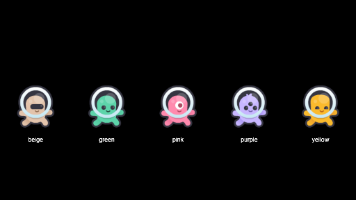
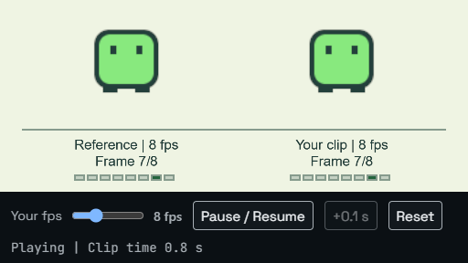
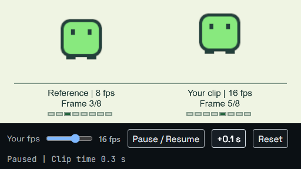
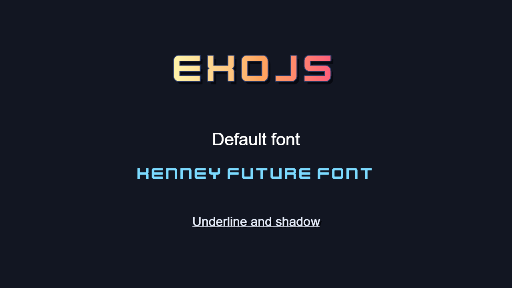
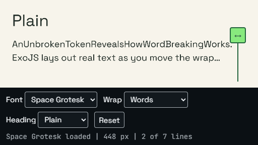
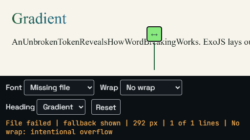

# Playground curation implementation

The working curriculum is the second-pass 48-example catalog dated 2026-10-23. The earlier 50-example asset proposal is superseded. [catalog.json](catalog.json) records every target, its primary source and batch, and all 111 original source dispositions. Target status describes implementation progress; it does not certify the entire curriculum.

Baseline: `next@7ca6a9d5eece7f9e69df26a04d688f4a5cf8255d`. Pilot branch: `feat/playground-curation-pilot`. No engine public API changes, merges, releases or gallery removals are included.

## Pilot scope

| Target              | Implemented behavior                                                                                                                                                                                          | Preserved source contracts                                                                                                                                | State                               |
| ------------------- | ------------------------------------------------------------------------------------------------------------------------------------------------------------------------------------------------------------- | --------------------------------------------------------------------------------------------------------------------------------------------------------- | ----------------------------------- |
| 19 Sprite Animation | The same eight-frame technical flipbook at fixed 8 fps and adjustable 1-24 fps; shared clip clock, pause, paused +0.1 s, deterministic reset and frame indicators                                             | `tweens-animation/frame-animation`: named clip playback, frame timing and pause/resume                                                                    | Locally verified; PR review pending |
| 23 Text Layout      | Real raster text, draggable/keyboard wrap edge, System/Space Grotesk/Kenney Future, genuine missing-font request, Words/Break words/No wrap, Plain/Outline/Shadow/Gradient, height-limited ellipsis and reset | `text-fonts/typographic-styling`: font loading and text styles; `text-fonts/multiline-and-wrap`: word wrapping, breaking and intentional no-wrap overflow | Locally verified; PR review pending |

The independent Multiline and Wrap source and its route remain runnable. Alignment, line height and underline remain documented in the existing text guides. The neutral flipbook needs no new art and can later be replaced by an approved animation sheet without changing the timing lesson.

The existing `demoPanel` has an opt-in `layout: 'bar'` presentation. It uses website tokens, native selects, 15px controls, compact layout and the installed website fonts. Existing panels keep their presentation. Preview font binaries and licenses come from the site's installed `@fontsource` dependencies; there is no new dependency or downloaded asset.

## PR #866 boundary

Checked on 2026-10-24: [#866](https://github.com/Exoridus/ExoJS/pull/866) is open, Draft and unmerged at `c7aaaabe9cafa6a5d545889ae8633c6c68726ffb`, based on the same `next` SHA. Neither pilot source is changed in that PR.

The only shared changed path is `examples/shared/runtime.ts` and its generated JavaScript. Its pointer-queue cleanup and duplicate-title conditional are left untouched. The pilot adds the optional bar in the later `demoPanel` section. Preview-host resizing/reload, AudioBus, mask, CRT and texture-disposal repairs remain owned by #866. Compatibility must be rechecked after that PR is integrated; no fix was copied or merged to unblock this pilot.

## Verification

The focused browser runner is `pnpm exec tsx site/scripts/curation-pilot-e2e.ts --backend webgl2` (use `--backend webgpu` and/or `--browser firefox`). It drives the real Playground, forces the requested backend without fallback, presents its iframe at exactly 1280x720 and 512x288, and writes captures and JSON results. Exact-size captures position the existing iframe independently of shell scrolling; they do not certify shell resizing, edited Reload or the Open button regressions owned by #866. A separate top-level preview check verifies the default font without a parent document.

The runner checks frame events over at least four seconds of clip time, pause over 0.6 seconds, three shared 0.1-second steps, keyboard control synchronization, pointer capture, wrap overflow, public text style values, compact ellipsis configuration/readout, genuine font failure, reset, displayed control dimensions, hidden-preview restoration and application teardown. Font loading uses a native FontFaceSet; text readouts use public `textBounds` metrics, without promoting internal engine APIs.

| Check                                                   | Result                                                                  |
| ------------------------------------------------------- | ----------------------------------------------------------------------- |
| `pnpm typecheck:examples`                               | PASS, exit 0                                                            |
| `pnpm --filter @codexo/exojs-examples check-ts:scripts` | PASS, exit 0                                                            |
| Named Unit/alias/sync/declaration/catalog tests         | PASS, 18 tests, exit 0                                                  |
| Chromium WebGL2, both targets and sizes, detached font  | PASS, 5 cases, exit 0                                                   |
| Chromium WebGPU, both targets and sizes, detached font  | PASS, 5 cases, exit 0                                                   |
| Firefox WebGL2, both targets and sizes, detached font   | PASS, 5 cases, exit 0                                                   |
| Firefox WebGPU                                          | BLOCKED: no adapter returned by the installed Firefox                   |
| Site/API/guide build                                    | PASS, exit 0, including preview font vendoring                          |
| CI and regular pre-push integration                     | Pending at this snapshot; see the Draft PR for subsequent check results |

Local hardware probe: Chromium 153.0.8010.12 uses ANGLE/D3D11 on NVIDIA GeForce RTX 5070 Ti for WebGL2 and NVIDIA Blackwell for WebGPU. Firefox 155.0 exposes an obfuscated ANGLE renderer string and no WebGPU adapter. These results certify this machine and browser configuration only.

An independent pilot review found missing fonts in detached previews and insufficient assertions for text effects/ellipsis. The missing-font regression was reproduced red and then passed after serving the existing website fonts. Public effect/layout assertions and per-style captures now cover the second finding. Human visual review and PR review remain separate from automated assertions.

## Rollout queue

Firefox exposes quoted CSS font-family names in `FontFace.family`; the status check accepts that browser serialization. Its failing detached-font assertion passed after this correction.

Original sources were read from the baseline SHA and run through the same Playground and forced backends. [Evidence](evidence/) includes both sizes, startup/interaction captures, each heading effect, detached previews and structured result records. All eight frozen text effect/failure screenshots are byte-identical between WebGL2 and WebGPU on this Chromium configuration; [text-parity.json](evidence/text-parity.json) records those comparisons. Animated startup frames have independent timing and are not compared by hash.

| Example          | Before, 512x288 WebGL2                                                     | After startup, 512x288 WebGL2                                                 | Interaction, 512x288 WebGL2                                                                     |
| ---------------- | -------------------------------------------------------------------------- | ----------------------------------------------------------------------------- | ----------------------------------------------------------------------------------------------- |
| Sprite Animation |  |  |             |
| Text Layout      |   |   |  |

## Remaining batches

| Batch | Next scope                                                                        | Prerequisite or limitation                                                                                           |
| ----- | --------------------------------------------------------------------------------- | -------------------------------------------------------------------------------------------------------------------- |
| B0V   | Finish reusable captions/status behavior and atlas extrusion/inset proof          | Optional bar is only a partial foundation; preserve #866 ownership                                                   |
| B1    | 20 Tweens and Easing; 21 Impact Feedback; 22 Shapes and Gradients; 24 Bitmap Text | Review the pilot foundation first; Impact Feedback directly overlaps #866                                            |
| B2    | 1-5, 16-18                                                                        | Preserve loading, lifecycle and focus contracts; Dialogue directly overlaps #866                                     |
| B3    | 10-15                                                                             | Verify coordinate mapping, action input and physical gamepad behavior                                                |
| B4    | 41-48                                                                             | Separate autotile logic/atlas proof and reproduce body-grab issues before engine changes                             |
| B5    | 34-40                                                                             | M1-M4 selection/licensing/calibration and human listening remain blocked inputs                                      |
| B6    | 6-9, 25-33                                                                        | Resolve direct #866 overlaps; prove rendering per backend                                                            |
| B7    | 48 normal gallery entries plus separate tools and runnable guides/diagnostics     | Only cut over after destination contracts are verified; retain deep links, snippets, embeds and offline distribution |

All 111 sources and catalog paths remain present. No merge, guide/tool migration or retirement is marked verified merely because its destination appears in the target matrix. The 46 remaining targets are queued, with their exact primary sources and responsible batches recorded in the catalog.
